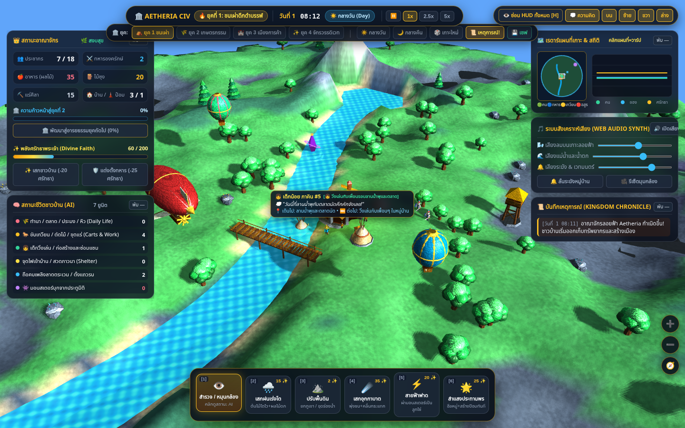

# AETHERIA — Floating Island God Simulator & Kingdom Defense

ต้นแบบเกมเกาะลอยฟ้า: ดูแลชาวบ้าน เก็บทรัพยากร ใช้พลังเทพ ปรับภูมิประเทศ และป้องกันอาณาจักรจากอสูรยามค่ำคืน มีอารยธรรม 4 ยุคและเหตุการณ์ให้ตัดสินใจ

> **สถานะ:** development prototype / sandbox ยังไม่ใช่เกมสมบูรณ์ ตัวต้นฉบับใช้ **custom WebGL renderer ที่เลียนแบบ API ของ Three.js** ไม่ได้ใช้แพ็กเกจ `three` จริง การย้ายไป Three.js เป็นงานระยะถัดไป



## เวอร์ชันออนไลน์

[เปิดเล่น AETHERIA บน GitHub Pages](https://wnau34-nptrn.github.io/aetheria-god-kingdom-defense/)

เผยแพร่จาก `main` หลังการตรวจผ่าน อ่าน [คู่มือ Pages](docs/PAGES.th.md) สำหรับขั้นตอนและการตรวจเวอร์ชันออนไลน์

อ่าน [แนวทางทดลองผ่านคืนแรกที่ 1x/5x](docs/PLAYTEST_GUIDE.th.md) เพื่อส่งผลเรื่องความเข้าใจและความยาก

## เริ่มพัฒนา

ต้องใช้ Node.js 22.12 ขึ้นไป

```bash
npm ci
npm run dev
```

เปิด URL ที่ Vite แสดง ใช้ HTTP server แทนการเปิด `index.html` ด้วย `file://` เนื่องจากแยกเป็น ES modules แล้ว

```bash
npm run build
npm run preview
npm test
npx playwright install chromium
npm run test:browser
```

หากใช้ Chromium ที่ติดตั้งในระบบ: `CHROMIUM_PATH=/usr/bin/chromium npm run test:browser` การทดสอบเบราว์เซอร์ใช้ software WebGL เพื่อให้ทำซ้ำใน CI ได้ ไม่ใช่การวัด FPS บน GPU จริง

ผลตรวจล่าสุด: [เล่นผ่านกลางวัน–กลางคืนด้วย UI ใหม่](docs/DAY_NIGHT_UX_REVIEW.th.md) พร้อมการแก้เสียง ข้อความแจ้งเมื่อใช้พลังไม่ได้ และคำแนะนำฟื้นเมือง

## วิธีเล่น

- ลากเพื่อหมุนกล้อง, Shift + ลากหรือปุ่มกลางเพื่อเลื่อน, ล้อเมาส์เพื่อซูม; WASD / ลูกศรเพื่อเลื่อนกล้อง
- เลข 1–6 เลือกสำรวจ ฝน ปรับพื้น อุกกาบาต สายฟ้า หรือพรสร้างป้อม แล้วคลิกพื้นเกาะ
- มือถือใช้นิ้วเดียวหมุนกล้อง/ใช้พลัง สองนิ้วเพื่อเลื่อนและซูม
- ใช้ปุ่มเวลาเพื่อหยุด/เร่งเกม, ปุ่มรีเซ็ตมุมกล้อง และปุ่มซ่อน HUD; เหตุการณ์จะหยุด simulation ระหว่างเลือก
- **แถบสลับยุค กลางวัน/กลางคืน และเกาะใหม่เป็นเครื่องมือ sandbox** ไม่ใช่กติกา progression ของเกมฉบับสมบูรณ์
- ปุ่มเซฟบันทึกวัน เวลา ทรัพยากร และยุคในเบราว์เซอร์เท่านั้น **ยังไม่เก็บเกาะที่ปั้น อาคาร ยูนิต หรือสถานะศึก** ไม่มี autosave ในรุ่นนี้

## โครงสร้าง

```text
index.html                      DOM / HUD
src/main.js                     เริ่มแอปและแจ้งข้อผิดพลาด WebGL
src/legacy/webgl-engine.js       ตัวเรนเดอร์เดิม (ไม่ใช่ Three.js)
src/legacy/game.js               เกมเดิมที่แยกไฟล์และแก้บั๊กสำคัญ
src/systems/progress-save.js     ตรวจสอบ checkpoint ก่อนโหลด
src/systems/fixed-step.js        นาฬิกา simulation สำหรับทุกความเร็ว
src/systems/food-target.js       เลือกแหล่งอาหารใกล้ตัวสำหรับ NPC
src/styles/game.css             หน้าตาเดิม
original/                       HTML ที่อัปโหลด เก็บเหมือนเดิมทุกไบต์
docs/                           ผลวิเคราะห์ สถาปัตยกรรม แผนพัฒนา และหลักฐานภาพ
tests/                          unit tests และ browser smoke tests
```

## ผลตรวจและแนวทางพัฒนาต่อ

[ข้อมูลสถานการณ์และการวางหอคอย](docs/READABILITY_REVIEW.th.md): แถบศรัทธา/อาหาร/คน/อสูร คำเตือนก่อนคืนแรก และเหตุผลเมื่อวางป้อมไม่ได้ พร้อมการเล็งด้วยสัมผัส

[ผลเล่นซ้ำและแก้การอยู่รอดของ NPC](docs/BALANCE_REVIEW.th.md): แก้จุดเกิดริมแม่น้ำ ทางออกสะพาน การหาอาหาร ที่พัก และจุดยืนตกปลา พร้อมหลักฐานแยกการเล่นผ่าน UI ออกจากการทดลองแบบควบคุม

[ผลตรวจและแก้ 1x/5x](docs/SPEED_REVIEW.th.md): เพิ่ม simulation tick คงที่ แก้คาราวานซื้อฟรีและกรณีสภาหาที่สร้างไม่ได้ พร้อมผลก่อน/หลังและชุดทดสอบ

อ่าน [บันทึกการเล่นต่อเนื่อง 25 นาที](docs/PLAYTHROUGH.th.md) และ [บัญชีระบบเดิม](docs/SYSTEMS.th.md) ก่อนเลือกงานเพิ่มระบบ จากนั้นอ่าน [ผลวิเคราะห์ภาษาไทย](docs/AUDIT.th.md), [แผนพัฒนา](docs/ROADMAP.th.md), [สถาปัตยกรรมและแผนย้าย Three.js](docs/ARCHITECTURE.md) และ [ผลทดสอบ](docs/VALIDATION.md)

รุ่นเตรียม repository นี้แก้การคืนค่าหยุดเกมหลังเหตุการณ์ เวลาโจมตีกับการหยุดเกม การใช้พลัง touch ซ้ำ การข้ามยุคผ่านปุ่มพัฒนาก่อนครบเงื่อนไข และความน่าเชื่อถือของการบันทึก พร้อมรองรับดัชนี mesh ขนาดใหญ่และแจ้งเมื่อ WebGL เริ่มไม่ได้ ยังรักษารูปแบบภาพและกลไกหลักเดิมไว้

## การร่วมพัฒนาและการนำไปใช้

ดู [CONTRIBUTING.md](CONTRIBUTING.md) ก่อนแก้ระบบ ตัวอย่างต้นฉบับอยู่ใน `original/` เพื่อเปรียบเทียบพฤติกรรมได้เสมอ

ยังไม่ได้กำหนดสัญญาอนุญาตเผยแพร่ซ้ำหรือใช้เชิงพาณิชย์ของตัวเกมและภาพที่ฝังมา ต้องให้เจ้าของผลงานระบุสิทธิ์ก่อนแจกจ่ายต่อ รายการ dependency ดูได้ใน `package-lock.json`; แพ็กเกจ npm มีสัญญาอนุญาตของแต่ละแพ็กเกจ
