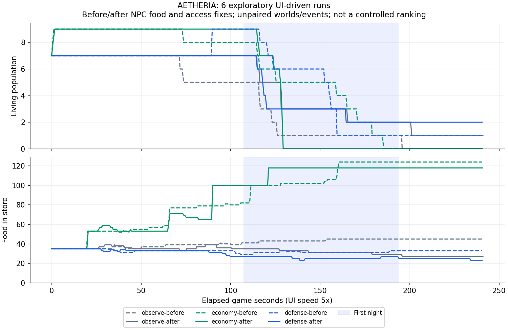

# ตรวจวงจรเมือง อาหาร และการป้องกันหลังแก้ฐานเวลา

## สิ่งที่ต้องแก้ก่อนตัดสินสมดุล

การเล่นซ้ำพบปัญหา NPC ที่ทำให้การเตรียมเมืองและการหลบภัยเสียหาย จึงควรแก้การเดิน การหาอาหาร และการเลือกที่พักก่อนปรับลด HP/ความเสียหายของศัตรู

### จุดเกิดอยู่ในเขตกันเดินริมแม่น้ำ

ชาวบ้านเริ่มต้น #3 เกิดที่ประมาณ `(-5.5, 0)` ซึ่งอยู่ในขอบเขตที่ระบบเดินถือเป็นแม่น้ำ แม้ภาพดูเหมือนริมฝั่ง เขาไม่ขยับออกจากจุดเกิดและอดตาย ทั้งที่คลังมีอาหาร 45 หน่วย ในการเล่นก่อนแก้ ตายวันที่ 1 ประมาณ 17:02 ก่อนคืนแรก

แก้ให้คนที่เกิดในขอบเขตนี้เริ่มบนฝั่งที่ใกล้ที่สุด ยังคงจุดเกิดบนสะพานไว้ ไม่ย้ายคนทั่วไปที่เกิดบนพื้นเดินได้

### เดินวนตรงทางออกสะพาน

เงื่อนไขเดิมบังคับยูนิตใกล้สะพานกลับไปจุดออกซ้ำ แม้อยู่ฝั่งเดียวกับเป้าหมายแล้ว ทหารหิวจึงวนอยู่แถว `(5.45, 13)` แทนการไปกินเสบียง และแรงงานขนแร่จากฝั่งตะวันตกไม่ถึงคลัง

แก้ให้เดินเข้าทางสะพานเมื่อข้ามฝั่งหรือยังอยู่ในเขตแม่น้ำ เมื่อขึ้นฝั่งปลายทางแล้วเดินต่อไปยังเป้าหมายได้ การตรวจครอบคลุมไปขุดแร่ฝั่งตรงข้าม ขนกลับผ่านสะพานใต้/เหนือ และไปกินอาหารที่ 1x/5x โดยไม่ได้เพิ่มระบบ teleport หรือเปลี่ยนความเร็วเดิน

หลักฐานจาก logic integration ที่ seed 1234:

| กรณี | ก่อนแก้ | หลังแก้ |
|---|---|---|
| คน #3 หลัง 88 วินาทีเกม | ไม่ขยับและตาย; อาหาร 44 | เคลื่อนที่ กิน และยังมีชีวิต |
| ทหารตรงทางออกสะพาน หลัง 10 วินาทีเกม | หิว 94.5; อาหารยัง 10 | หิวประมาณ 11.7; อาหารลดเหลือ 9 |
| ขนแร่ผ่านสะพานใต้ หลัง 30 วินาทีเกม | แร่เข้าคลัง 0 | แร่เข้าคลัง 5 |
| ขนแร่ผ่านสะพานเหนือ หลัง 30 วินาทีเกม | แร่เข้าคลัง 5 | แร่เข้าคลัง 5 |

ตัวเลขตรงกันในทั้ง 1x/5x ของ fixture เหล่านี้ ไม่ได้แปลว่ามี pathfinding ที่แก้อุปสรรคภูมิประเทศได้ทุกแบบแล้ว

- [การเล่นก่อนแก้การเดิน](balance-review/pre-navigation-fix/summary.json) — หยุดเมื่อพบสาเหตุ ไม่รวมกับรอบเปรียบเทียบ
- [ผลก่อนแก้](balance-review/navigation-before.json), [หลังแก้](balance-review/navigation-after.json)

### เลือกผลไม้ตามลำดับที่สร้าง แทนแหล่งอาหารใกล้ตัว

หลังแก้การเดิน ยังพบคนเดินเปลี่ยนเป้าหมายตามต้นผลไม้ที่คนอื่นเก็บก่อน จนอดตายระหว่างทางทั้งที่มีอาหารในคลัง การเพิ่มอาหารอย่างเดียวจึงไม่พอ ในรอบเศรษฐกิจพบการอดตายแม้มีอาหารกว่า 70 หน่วย

ทดลองแบบควบคุม 10 seed ที่ 5x ช่วง 107 วินาทีเกมก่อนคืนแรก: วิธีเดิมมีคนอดตายรวม 12 คน โดยทุกครั้งยังมีอาหารอย่างน้อย 2 หน่วย วิธีเลือกแหล่งอาหารใกล้ตัวไม่พบการอดตายในช่วงเดียวกัน และทั้ง 10 เผ่ายังคงมี 7 คน

วิธีใหม่เปรียบเทียบระยะตรงจากตัวคนกับคลังกลางที่มีอาหารพอหนึ่งมื้อ และต้นไม้ที่มีผลสุก เลือกแหล่งที่ใกล้กว่า ยังไม่ใช่การคำนวณค่าเส้นทางหลบอุปสรรคทั้งหมด ยังคงต้นทุนเดิม: กินคลังใช้ 2 อาหาร เก็บผลไม้เติม 2 อาหาร พลังฝนและอัตราความหิวไม่เปลี่ยน จึงทำให้อาหารในคลังถูกใช้จริงและอาจลดเร็วกว่าวิธีเดิม

[ผลทดลอง 10 seed](balance-review/food-choice-trial.json) เป็น logic integration ที่ควบคุมสุ่มและนาฬิกา ไม่ใช่การเล่นผ่าน WebGL และไม่ใช้แทนผลทดสอบสมดุลหลายผู้เล่น

### บ้านเริ่มต้นที่เดินเข้าไม่ได้

บ้านที่ `(-6.5, 5.2)` อยู่ในเขตกันเดินของแม่น้ำ NPC ที่เลือกบ้านนี้จึงค้างนอกบ้าน ไม่ได้เข้าสู่สถานะซ่อนตัว แม้มีบ้านอีกหลังที่เดินถึงได้ การตรวจแบบไม่มีศัตรูและไม่มีความหิวหลัง 15 วินาทีเกมยืนยันอาการทั้ง 1x/5x

แก้การเลือกที่พักให้ใช้บ้านที่สร้างเสร็จและไม่อยู่ในเขตกั้นแม่น้ำ เว้นแต่เป็นตำแหน่งบนสะพาน เมื่อไม่มีบ้านที่ผ่านเงื่อนไข จะกลับวิหารตามกติกาเดิม ไม่ย้ายอาคารหรือเปลี่ยนแผนที่ ในกรณีทดสอบเดิม NPC เข้าบ้านที่ใช้ได้จริง และกรณีเหลือบ้านที่เข้าถึงไม่ได้เพียงหลังเดียวก็กลับวิหารสำเร็จ

[ผลก่อน/หลังเลือกที่พัก](balance-review/shelter-check.json)

### รักษางานตกปลาเมื่อแก้แนวเดินริมแม่น้ำ

การตรวจอาชีพเพิ่มเติมพบผลข้างเคียงของแนวเดินใหม่: จุดตกปลาเดิมอยู่ในเขตกันเดิน ทำให้ผลผลิตเหลือ 2 อาหารใน fixture 13 วินาที จึงปรับจุดยืนตกปลาให้ตรงกับขอบฝั่งที่เดินได้ และใช้ตำแหน่ง Z ของชาวประมงแต่ละคน

หลังแก้ได้ 8 อาหารใน 13 วินาทีเท่ากันที่ 1x/2.5x/5x ในทั้งสอง seed โดยไม่เปลี่ยนอัตราจับปลา 2 อาหารต่อรอบ เพิ่มการตรวจจำนวนอาหารจริงควบคู่กับการตรวจความเท่ากันระหว่าง speed เพื่อป้องกันกรณีที่ทุก speed ให้ผลผิดเหมือนกัน

[ผลตรวจงานตกปลา](balance-review/fishing-check.json) และ browser fixture ตรวจการผลิตผ่าน WebGL จริง

### แถบ HUD บังปุ่มเวลาในจอแนวนอน

ที่ 400×300 แถบซ่อน HUD อยู่บนแถวเดียวกับนาฬิกาและทับปุ่ม 5x จนรับคลิกไม่ได้ แก้ให้แยกแถวบนจอแนวนอนกว้างไม่เกิน 960px และสูงไม่เกิน 500px ใช้การเลื่อนแนวนอนเมื่อพื้นที่ไม่พอ ตรวจปุ่ม 5x/pause/1x และซ่อน–แสดง HUD ที่ 400×300, 640×480 และ 844×390

[ภาพก่อนแก้](balance-review/screenshots/landscape-before.png), [หลังแก้](balance-review/screenshots/landscape-after.png)

## รอบเล่นผ่านหน้าเกม

ชุดเปรียบเทียบประกอบด้วยสามแนวทางก่อนแก้อาหาร/ที่พักที่ commit `21b50a6` และสามแนวทางหลังแก้ครบที่ commit `80e4cdf` ใช้แต่ละแนวทางหนึ่งรอบต่อเวอร์ชัน โดยไม่ได้จับคู่โลกสุ่มให้เหมือนกัน

เล่นครบหกรอบ เป้าหมายรอบละ 240 วินาทีเกม ผ่านกลางวัน คืนแรก เวฟหนุน และเช้าวันที่ 2 เวลาที่บันทึกจริงอยู่ระหว่าง 240.25–240.95 วินาทีเกมตามจังหวะเก็บ snapshot ไม่มี uncaught page error หรือ input automation error ในหกรอบนี้

| รุ่น | แนวทาง | คนเริ่มคืน | คนรุ่งอรุณ | คนจบรอบ | อาหารจบรอบ | อดตาย | ตายจากศึก |
|---|---|---:|---:|---:|---:|---:|---:|
| ก่อน | ช่วยเมืองน้อย | 5 | 0 | 0 | 45 | 2 | 5 |
| ก่อน | เศรษฐกิจ | 8 | 0 | 0 | 124 | 1 | 8 |
| ก่อน | ป้องกัน | 9 | 1 | 1 | 33 | 0 | 8 |
| หลัง | ช่วยเมืองน้อย | 7 | 2 | 1 | 27 | 0 | 6 |
| หลัง | เศรษฐกิจ | 9 | 0 | 0 | 118 | 0 | 9 |
| หลัง | ป้องกัน | 7 | 2 | 2 | 23 | 0 | 5 |

นับรุ่งอรุณเมื่อวันที่ 2 หลัง 06:00 และเก็บจำนวนคนจบรอบเพิ่ม เพราะอสูรไม่หายทันทีเมื่อเช้า จำนวนคนเริ่มคืนรวมผลการเสกคน/แต่งตั้ง/เหตุการณ์ก่อนศึกด้วย

การอดตายที่บันทึกในหกรอบนี้: ก่อนแก้ 3 คน หลังแก้ 0 คน ส่วนความสูญเสียจากการต่อสู้ยังสูง ในรอบเศรษฐกิจหลังแก้ พลเรือนเข้าซ่อนในบ้านได้จริงสูงสุด 7 คน แต่สุดท้ายเสียเมือง จึงต้องแยกการทำงานถูกต้องของ NPC ออกจากความเพียงพอของกำลังป้องกัน

อาคารที่เหลือก็มีความหมายต่อการฟื้นเมือง: รอบป้องกันก่อนแก้เหลือบ้าน 3 ป้อม 3 และเด็ก 1 คน ขณะที่รอบหลังแก้เหลือบ้าน 3 ป้อม 0 พร้อมชาวบ้าน 1 คนและเด็ก 1 คน จำนวนคนรอดเพียงค่าเดียวจึงไม่พอประเมินคุณภาพของผลการรบ

จำนวนแม่ทัพและเหตุการณ์ต่างกัน จึงใช้ตารางนี้จัดอันดับกลยุทธ์หรืออ้างว่าผลรอดศึกเปลี่ยนเพราะแก้ NPC เพียงอย่างเดียวไม่ได้:

| รอบ | แม่ทัพในเวฟแรก | ทางเลือกเหตุการณ์ที่เกิดเอง |
|---|---:|---|
| ก่อน / ช่วยเมืองน้อย | 4 | ปิดเหตุการณ์ |
| ก่อน / เศรษฐกิจ | 1 | สวดภาวนา |
| ก่อน / ป้องกัน | 4 | ป้อมและทหาร |
| หลัง / ช่วยเมืองน้อย | 2 | ปิดเหตุการณ์ |
| หลัง / เศรษฐกิจ | 4 | งานเลี้ยง/ฝน |
| หลัง / ป้องกัน | 2 | สวดภาวนา |



[กราฟ SVG](balance-review/population-food.svg), [ตัวเลขสรุป](balance-review/metrics.json), [ข้อมูลเส้นกราฟ](balance-review/series.json)

ข้อมูลและ timeline ดิบอยู่ใน [ชุดก่อนแก้](balance-review/before-food-fix/metadata.json) และ [ชุดหลังแก้](balance-review/after-npc-fix/metadata.json) พร้อม snapshot/ภาพของแต่ละรอบ ตัวอย่างภาพสถานะเมืองหลังแก้: [ช่วยเมืองน้อย](balance-review/after-npc-fix/observe-1/screenshots/final-city-status.png), [เศรษฐกิจ](balance-review/after-npc-fix/economy-1/screenshots/final-city-status.png), [ป้องกัน](balance-review/after-npc-fix/defense-1/screenshots/final-city-status.png)

มีรอบวินิจฉัยเลือกอาหารอย่างเดียวที่ `0dec70f` อีกหนึ่งรอบเต็ม เก็บแยกใน [food-only-diagnostic](balance-review/food-only-diagnostic/metadata.json) พร้อม directory รอบเศรษฐกิจที่หยุดกลางทาง ไม่รวมชุดนี้หรือรอบก่อนแก้ทางเดินกับหกรอบเปรียบเทียบ

## งานถัดไปจากสิ่งที่เห็นในการเล่น

1. แยกเหตุผลเมื่อวางป้อมไม่ได้เป็นถนน แม่น้ำ ความชัน หรือใกล้อาคาร ในรอบป้องกันต้องลองหลายจุดก่อนสำเร็จ ข้อความรวมเดิมไม่ช่วยให้รู้ว่าควรแก้ตรงไหน ควรตรวจผังเมืองเริ่มต้นด้วยกฎเข้าถึงเดียวกัน รวมถึงบ้านในเขตแม่น้ำที่รอบนี้กรองออกจากการเลือกที่พัก
2. ตรวจการอ่านศึกกลางคืนเมื่อพับแผงด้านข้าง โดยเน้นศรัทธา อาหาร จำนวนภัยคุกคาม และการกลับมุมกล้อง การมีปุ่มซ่อน HUD/กระโดดไปศึกอยู่แล้วไม่ได้รับรองว่าผู้เล่นใหม่จะหาเจอ
3. ระบุข้อมูลคน/บ้าน/ป้อม/โบนัสที่ต้องคงเมื่อเปลี่ยนยุค และทำ full world save ก่อนลงทุนกับ asset จำนวนมาก การขึ้นยุคปัจจุบันสร้างเมืองและคนชุดใหม่ จึงต้องแยกการฟื้นประชากรจากการรอดศึก

ยังไม่ได้เปลี่ยนความแรงศัตรู กติกาคุ้มครองวิหาร หรือเพิ่ม game-over การทดสอบกับผู้เล่นมนุษย์บนเวอร์ชันแก้ NPC ควรมาก่อนสรุปว่าจะปรับความยากอย่างไร

## วิธีเก็บข้อมูลและขอบเขต

- Playwright กดปุ่ม/คีย์บอร์ด/คลิกพลังบน canvas ผ่านเกมจริง ใช้ API อ่านสถานะและคำนวณการเล็งเท่านั้น ไม่มีการเขียนทรัพยากร HP เวลา ยุค หรือสร้างเวฟผ่าน API
- แต่ละรอบใช้ browser context ใหม่ ค่า terrain เริ่มต้น 42026 และ props/คน/ศัตรู/เหตุการณ์สุ่มตามเกม ไม่มีการบังคับ seed ให้เท่ากันระหว่างรอบ browser
- ใช้ปุ่ม 5x ไม่ข้ามวันคืน ไม่กดเลือกยุค และไม่เรียกเหตุการณ์เอง มีเฉพาะเหตุการณ์ที่เกิดตามเวลา เลือกหรือปิดตามแนวทางของรอบนั้น
- รอบ browser ทั้งหมดใช้ 5x การเทียบ 1x/5x ในรายงานนี้เป็น controlled logic เท่านั้น ไม่ครอบคลุมจำนวนโอกาสเกิดเหตุการณ์หรือ auto-advance ยุค ซึ่งยังใช้กติกาเดิม
- ใช้กล้องซูมออกผ่าน mouse wheel ถึงระยะปกติที่เกมอนุญาต และ pause ผ่าน UI เพื่อเล็ง/บันทึกภาพ ช่วงเก็บข้อมูลใช้หน้าต่าง 400×300 และขยายเป็น 800×600 เมื่อบันทึกภาพ บันทึกเป็น Chromium + SwiftShader ไม่ stub renderer
- นโยบายเศรษฐกิจเสกคน 2 คนและใช้ฝนเป็นระยะ นโยบายป้องกันแต่งตั้งทหาร 2 นาย พยายามเพิ่มป้อมหนึ่งแห่ง และใช้สายฟ้ากับกลุ่มศัตรู ระยะห่างการใช้พลังในสคริปต์เป็นข้อกำหนดการทดลอง **ไม่ใช่ cooldown ของเกม**
- การตอบสนองเป็นนโยบายสคริปต์ที่อ่านตำแหน่งศัตรูได้และ pause เล็งได้ ไม่ใช่ผู้เล่นมนุษย์หรือกลยุทธ์ที่พิสูจน์ว่าเหมาะสมที่สุด ไม่ได้ทดสอบการฟื้นเมืองหลังคืนแรกในรอบเปรียบเทียบนี้
- จำนวนรอบต่อแนวทางและเวอร์ชันมีน้อย อีกทั้งเหตุการณ์และประเภทศัตรูต่างกัน จึงใช้ชี้พฤติกรรมและปัญหาซ้ำ ไม่ใช้จัดอันดับกลยุทธ์หรือรับรองว่าสมดุลเสร็จแล้ว
- เครื่องประมวลผลภาพด้วย CPU และเกมยังมี frame clamp/render delay เดิม เวลา wall clock จึงใช้แทนความเร็วเล่นหรือ FPS บนอุปกรณ์จริงไม่ได้

## การตรวจโค้ดและทำซ้ำ

โค้ดเกม commit `80e4cdf` ผ่าน **75 unit/integration tests**, **10 browser tests** ที่ใช้ WebGL จริง และ production build ทั้งในเครื่องทดสอบและ [GitHub Actions](https://github.com/wnau34-nptrn/aetheria-god-kingdom-defense/actions/runs/38785655441)

ชุดตรวจยังครอบคลุมผลตัวเลือกเหตุการณ์ทั้ง 15 ข้อ การหยุด/คืนเวลา การบันทึก/โหลดและ storage failure, touch ใช้พลังครั้งเดียว และกรณี WebGL ใช้ไม่ได้ รวมกับกรณีการเดิน อาหาร ที่พัก และงานตกปลาที่เพิ่มรอบนี้ รายการ browser บางข้อใช้ fixture ควบคุมตามที่ระบุในโค้ด ไม่ปะปนกับ timeline การเล่นธรรมชาติ

รอบ browser ใช้เวลานานและต้องมี dev server เปิดอยู่ แยกจากชุด CI ปกติ:

```bash
npm ci
npm run dev -- --port 5173 --strictPort
# อีก terminal
BALANCE_REPEATS=1 BALANCE_EVIDENCE=/tmp/aetheria-new-playtest node tests/balance-playthrough.mjs
NAV_REPORT=/tmp/aetheria-navigation-current.json node tests/compare-navigation.mjs
FOOD_REPORT=/tmp/aetheria-food-current.json node tests/compare-food.mjs
git show 0dec70f:src/legacy/game.js > /tmp/aetheria-access-before.js
ACCESS_BASELINE_SOURCE=/tmp/aetheria-access-before.js node tests/compare-npc-access.mjs
BALANCE_EVIDENCE=/tmp/aetheria-new-playtest node tests/summarize-balance.mjs
BALANCE_EVIDENCE=/tmp/aetheria-new-playtest python tests/plot-balance.py  # optional; matplotlib >= 3.7
```

ใช้ `CHROMIUM_PATH=/usr/bin/chromium` ได้หากใช้ browser ในระบบ เลือกโฟลเดอร์ใหม่สำหรับ browser run แต่ละครั้ง เพราะสคริปต์ไม่เขียนทับ metadata เดิม อ่าน metadata ของแต่ละ phase เพื่อเทียบ commit/hash กับหลักฐานเดิม สคริปต์ไม่ทำให้ browser run ที่สุ่มตามธรรมชาติได้ผลซ้ำเหมือนเดิมทุกค่า `compare-npc-access.mjs` เขียนผลใน `docs/balance-review/` เมื่อสั่งทำซ้ำ
