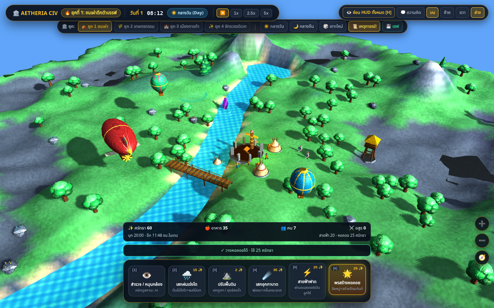
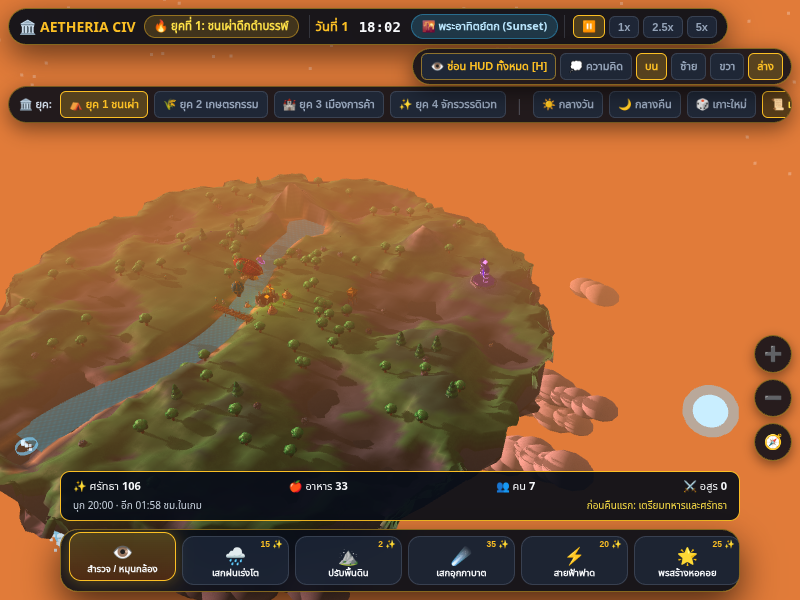

# อ่านสถานการณ์และวางหอคอยให้เข้าใจได้

รอบนี้ต่อยอดจาก `2790b18` ให้ผู้เล่นรู้ว่าเหตุใดวางหอคอยไม่ได้และเห็นทรัพยากรสำคัญเมื่อพับแผงข้าง การปรับนี้ยังไม่เปลี่ยนจำนวนศัตรู พลังโจมตี ราคาพลัง รายได้ หรือกติกา sandbox

## สิ่งที่เปลี่ยน

- ใช้ผลตรวจตำแหน่งเดียวกันสำหรับวงเล็ง ข้อความ และการสร้างจริง แยกแม่น้ำ ถนน พื้นต่ำใกล้น้ำ พื้นสูงเกินไป ความชัน ใกล้สิ่งปลูกสร้าง และนอกเกาะ เมื่อมีหลายข้อจำกัดจะแสดงเหตุผลแรกที่ตรวจพบ
- วงเล็งสีเขียวหมายถึงสร้างได้ สีแดงหมายถึงตำแหน่งติดข้อจำกัดหรือศรัทธาไม่ถึง 25 การสร้างสำเร็จยังสร้างป้อมพร้อมฮีลหมู่ตามพลังเดิม และตำแหน่งนั้นจะเปลี่ยนเป็นติดฐานอาคารทันที
- มือถือแตะ/ลากเพื่อเล็งแล้วปล่อยเพื่อสร้างหนึ่งครั้ง การเริ่มใช้สองนิ้ว ยกเลิก touch หรือปล่อยนิ้วเหนือ HUD จะไม่สร้างหอคอย ปุ่มพลังอื่นยังใช้พฤติกรรมเดิม
- ปุ่มพลังเดิมใช้ชื่อ “พรสร้างหอคอย” ให้สอดคล้องกับคำแนะนำบนแถบ แม้หน้าจอมือถือซ่อนคำอธิบายย่อยของพลัง
- แถบเหนือปุ่มพลังแสดงศรัทธา อาหาร คนที่มีชีวิต และอสูรที่มีชีวิต ไม่ต้องเปิดแผงสถิติ ปุ่มกล้องมือถือเลื่อนขึ้นตามความสูงของแถบเพื่อไม่ทับข้อมูล
- แสดงเวลาที่เหลือก่อนการบุก 20:00 เป็น **ชั่วโมงในเกม** เวลา 18:00–20:00 ของวันแรกแสดงคำแนะนำเตรียมทหารและศรัทธา พร้อมบันทึกคำเตือนตอนข้าม 18:00 ไม่เปิด modal และไม่พักเกมเอง
- ปุ่ม H และการซ่อนแถบพลังยังควบคุมข้อมูลใหม่นี้ด้วย สถานะการรบนับเฉพาะอสูรที่ยังมีชีวิต แม้ array ยังไม่เก็บกวาดร่างที่ตาย

## การตรวจสอบ

การทดลองเทียบกฎตำแหน่งก่อน/หลังใช้ geometry เกมจริงใน jsdom, seed 1234, ยุค 1–4 และกริดระยะ 2 หน่วยตั้งแต่ −80 ถึง 80 รวม **26,244 จุด** ไม่พบผลอนุญาต/ปฏิเสธต่างกัน หลักฐาน: [placement-compatibility.json](readability-review/placement-compatibility.json) การตรวจนี้ไม่ครอบคลุมพิกัดต่อเนื่องทุกจุดหรือเกาะสุ่มทุก seed

`placement-readout.test.js` ตรวจว่าการสร้างที่ถูกปฏิเสธไม่หักศรัทธา ไม่สร้างอาคาร และไม่ฮีล; ศรัทธา 24/25 บนพื้นที่ว่าง; สร้างซ้ำบนฐานเดิมไม่ได้; การเตือนและ pause ที่ 1x/5x; และการนับเฉพาะคน/ศัตรูที่ยังมีชีวิต

`placement-readout.spec.js` ใช้ WebGL จริงกับเมาส์/สัมผัสผ่าน Chromium ตรวจเหตุผลสี่ชนิด การสร้างสำเร็จ การเปลี่ยนพลัง การปล่อยนิ้วสร้างครั้งเดียวและยกเลิกด้วยสองนิ้ว รวมถึงข้อมูลอยู่ครบในจอ 390×844, 400×300 และ 844×390 ปุ่มกล้องบนจอแนวนอนเรียงเป็นแถวเหนือแถบข้อมูลและอยู่ใต้แถบยุค การอ่าน API ใช้ตรวจผลและหาตำแหน่งเล็ง ไม่มีการเขียน world state ในชุดนี้

## เล่นต่อเนื่องถึงคืนแรกผ่าน UI

รอบเพิ่มเติมใช้โค้ด `f943b09` เล่นผ่าน UI ต่อเนื่องหนึ่งครั้ง **แบบผสมความเร็ว**: ใช้ 5x ช่วงเช้าและระหว่างจุดตรวจ สลับเป็น 1x ตอนข้าม 18:00 และ 20:00 จากนั้นตรวจสถานะเดียวกันที่ 5x อีกครั้ง ไม่ใช่การเล่นเต็มวันแยกสองความเร็วหรือการทดลองสมดุล ใช้การเลื่อนล้อเมาส์ซูมออก ปิดเหตุการณ์ที่เกิดเองหนึ่งครั้ง และพักเกมผ่านปุ่มจริงเพื่อถ่ายภาพ ไม่มีการข้ามเวลา บังคับคลื่นศัตรู หรือแก้ world state ผ่าน API

เก็บ **204 snapshots**, ใช้เวลารันประมาณ **286 วินาที** และไม่พบ page error ทุก snapshot ที่ตรวจมีจำนวนคนและอสูรบน HUD ตรงกับหน่วยที่มีชีวิตในโลก เกมเดินต่อเนื่องถึงประมาณ 20:21 ของวันแรกโดยไม่มีการ reload หรือย้อน simulation clock

| จุดตรวจ | ความเร็วก่อนกดพัก | เวลาเริ่มตรวจ | คน / อสูร |
| --- | --- | --- | --- |
| คำเตือนก่อนคืนแรก | 1x | 18:00 | 7 / 0 |
| คำเตือนยังแสดงเมื่อเร่งเวลา | 5x | 18:18 | 7 / 0 |
| ระลอกแรกเริ่มบุกตามเวลา | 1x | 20:00 | 7 / 7 |
| จำนวนอสูรเมื่อกลับไปเร่งเวลา | 5x | 20:18 | 7 / 7 |

ทั้งสี่จุดตรวจยืนยันว่า simulation time และตัวนับไม่เปลี่ยนระหว่างพัก การกดปุ่มพักใช้เวลาระหว่างรับ input จึงมีเวลาในภาพช้ากว่าเวลาเริ่มตรวจเล็กน้อย ภาพ 400px เป็น viewport ขณะรัน ส่วนภาพ 800px ขยายตอนพักเพื่ออ่านรายละเอียด หลักฐานและคำสั่งทำซ้ำอยู่ใน [readability-review/README.md](readability-review/README.md), [summary.json](readability-review/natural/summary.json) และ [timeline.jsonl](readability-review/natural/timeline.jsonl)

CI รอบ `f943b09` ผ่าน unit/build และ browser 13 จาก 15 กรณี อีกสองกรณีรอ opacity กลับเป็น 1 ไม่ทันขอบเขต 5 วินาทีบน software renderer จึงเปลี่ยนการตรวจ H ให้ยืนยันสถานะซ่อน/แสดงและ `pointer-events` โดยตรง แทนการใช้เวลาจบเอฟเฟกต์ตกแต่งเป็นเกณฑ์ ไม่ได้เพิ่ม timeout หรือเปลี่ยนความเร็วเกม

## ขอบเขตผล

ตัวเรนเดอร์ยังเป็น WebGL compatibility engine เดิมที่ใช้ชื่อ `window.THREE` การทดสอบใช้ Chromium/SwiftShader จึงไม่ใช่ผล GPU จริงหรือการยืนยันบน Safari/iOS การปรับความยากและช่วงเตรียมเมืองยังต้องใช้ผู้เล่นมนุษย์เพื่อประเมินว่าเข้าใจคำเตือนและใช้พลังทันหรือไม่ การรันสคริปต์ไม่ยืนยันความสนุก

ก่อนเริ่มเปลี่ยนตัวเลขสมดุล ควรให้ผู้เล่นลองผ่านคืนแรกที่ 1x และ 5x แล้วบันทึกว่ารู้เวลาเริ่มบุกหรือไม่ เข้าใจสาเหตุที่วางป้อมไม่ได้หรือไม่ และแพ้เพราะตัดสินใจ/เตรียมเมืองหรือปัญหา AI จากนั้นจึงปรับตัวแปรทีละกลุ่ม

ช่วง 18:00–20:00 เท่ากับประมาณ 18.18 วินาทีของ simulation ตามสูตรนาฬิกาเดิม ไม่ควรใช้เวลารันบน software renderer ตัดสินว่าผู้เล่นมีเวลาอ่านและกดพักเพียงพอบนเครื่องจริง โดยเฉพาะเมื่อใช้ 5x
